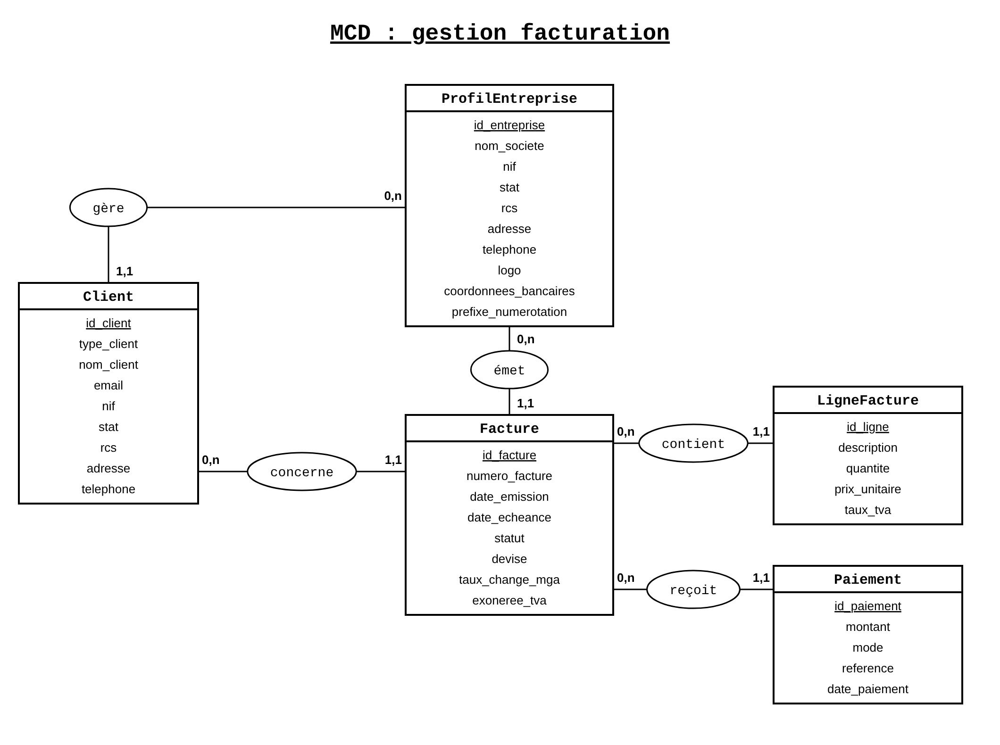

# Facturia

Application de gestion de factures pour une entreprise. Elle sert à gérer les clients, créer et valider des factures, suivre les paiements et produire un PDF.

L'utilisateur est l'entreprise qui émet les factures. Le client reçoit la facture mais n'a pas de compte.

Le projet est adapté à Madagascar : montants en Ariary, NIF, STAT, RCS. Les factures peuvent aussi être en euros ou en dollars. La TVA est de 20 % par défaut, avec une option d'exonération.

## Technologies

- **Django REST Framework** : API, modèles, validations et règles métier.
- **Simple JWT** : connexion avec des jetons.
- **React + Vite** : pages et formulaires.
- **MySQL** : base de données par défaut. `DATABASE_URL` peut la remplacer.
- **ReportLab** : création des PDF.
- **Axios** appelle l'API. **Chart.js** affiche le graphique.

## Structure

```text
backend/
  config/            settings, urls, asgi, wsgi
  factures/
    models.py        modèles et calculs
    serializers.py   format et validation des données
    views.py         API et tableau de bord
    urls.py          routes
    pdf.py           factures PDF
    admin.py         administration Django
    migrations/      historique de la base
    management/commands/charger_registre.py   entreprises fictives
  manage.py
  requirements.txt
  build.sh           installation, statiques, migrations
frontend/
  src/
    App.jsx, main.jsx, api.js, utils.js
    pages/           Inscription, Connexion, TableauDeBord, ListeFactures,
                     EditeurFacture, DetailFacture, ListeClients, Parametres
    components/      Layout, ApercuFacture, LignesFacture, TotauxFacture,
                     RechercheClient, FormulairePaiement, HistoriquePaiements,
                     BadgeStatut
    scss/            styles
  vite.config.js, package.json
```

## Modèle de données

- **ProfilEntreprise** : l'entreprise liée à un compte (infos, logo, coordonnées de règlement, préfixe de numérotation).
- **Client** : appartient à une entreprise. Particulier ou entreprise.
- **Facture** : appartient à une entreprise et à un client. Elle a des dates, un statut, une devise, un taux de change et une copie des infos de l'émetteur et du client. le mieux c'est de rechercher un client existant sinon elle serait perçue comme un nouveau client et peut empêche la finalisation de la facture.
- **LigneFacture** : description, quantité, prix unitaire, TVA. Les montants sont calculés.
- **CompteurFacture** : dernier numéro utilisé, par entreprise et par année.
- **Paiement** : montant, mode, référence, date. Une facture peut en avoir plusieurs.
- **RegistreNationalEntreprise** : entreprises fictives pour la recherche. Non lié à un utilisateur.

Les lignes et les paiements sont supprimés avec leur facture. Un client qui a des factures ne peut pas être supprimé.

### MCD
le MCD propre du projet se trouve dans:


## Règles métier

**Cycle d'une facture.** Brouillon, puis Envoyée (à la validation, avec un numéro), puis Payée (après paiement complet). Un brouillon peut être modifié ou supprimé. Après la validation, plus rien ne change.

**Numérotation.** Le numéro est `PRÉFIXE-ANNÉE-NUMÉRO`, par exemple `FAC-2026-0001`. Le compteur est séparé par entreprise et par année. Le préfixe ne peut plus changer dès qu'une facture est validée.

**Données figées.** À la validation, les infos de l'émetteur et du client sont copiées dans la facture. Si le profil ou le client change ensuite, la facture reste identique. Le logo n'est pas copié.

**TVA et devises.** Chaque ligne a son taux de TVA (20 % par défaut). Les montants sont arrondis à 2 décimales. L'exonération met la TVA à zéro. Les devises sont MGA, EUR et USD. En MGA, le taux de change vaut 1. En EUR ou USD, l'utilisateur saisit le taux. À la validation, `total_mga` est calculé avec ce taux.

**Identifiants.** Téléphone : 10 chiffres. NIF : 10 chiffres. STAT : 17 chiffres. Un client entreprise doit avoir NIF, STAT et RCS (10 à 40 caractères). Un particulier n'a pas ces trois champs.

**Paiements.** Un paiement n'est possible que sur une facture envoyée. Le montant doit être positif et ne pas dépasser le reste à payer. La date ne peut pas être avant l'émission ni dans le futur. Les paiements partiels sont permis. Quand le reste est à zéro, la facture passe à Payée. Modes : virement, Mvola, Orange Money, Airtel Money, espèces. C'est un simple enregistrement, pas un vrai paiement en ligne. Si le total d'une facture est nul, elle est marquée payée directement.

**Séparation des données.** Chaque entreprise ne voit que ses clients et ses factures. La recherche du registre est commune à tous les utilisateurs connectés.

## Parcours complet

1. **Inscription** : `/inscription` appelle `POST /api/auth/register/`, puis `POST /api/auth/token/`.
2. **Connexion** : `/connexion` appelle `POST /api/auth/token/`, puis `GET /api/dashboard/`.
3. **Paramètres** : `/parametres` utilise `GET` et `PATCH /api/profil/`.
4. **Facture** : `/factures/nouvelle` cherche un client avec `GET /api/clients/?q=...` ou le registre avec `GET /api/recherche-societe/?q=...`. Il enregistre le brouillon avec `POST /api/factures/`, ou `PUT /api/factures/{id}/` pour le modifier.
5. **Validation et PDF** : `/factures/{id}` utilise `POST /api/factures/{id}/valider/` et `GET /api/factures/{id}/pdf/`.
6. **Paiement** : `POST /api/factures/{id}/payer/`. La réponse contient la facture et ses paiements.

## API

Toutes les routes commencent par `/api`. Les routes d'inscription et de jetons sont publiques. Les autres demandent un jeton.

| Méthode | URL | Rôle |
|---|---|---|
| POST | `/auth/register/` | Créer un compte |
| POST | `/auth/token/` | Obtenir les jetons |
| POST | `/auth/token/refresh/` | Renouveler le jeton |
| GET, PUT, PATCH | `/profil/` | Lire ou modifier le profil |
| GET | `/recherche-societe/?q=` | Chercher dans le registre |
| GET | `/dashboard/` | Indicateurs |
| GET, POST | `/clients/` | Lister ou créer |
| GET, PUT, PATCH, DELETE | `/clients/{id}/` | Lire, modifier, supprimer (sans facture) |
| GET, POST | `/factures/` | Lister (filtre `statut`) ou créer un brouillon |
| GET, PUT, PATCH, DELETE | `/factures/{id}/` | Lire, modifier, supprimer (brouillon seulement) |
| POST | `/factures/{id}/valider/` | Valider et numéroter |
| POST | `/factures/{id}/payer/` | Ajouter un paiement |
| GET | `/factures/{id}/pdf/` | Télécharger le PDF |

## Tableau de bord

Les calculs utilisent `total_mga`, enregistré à la validation.

- **Encaissé** : total des factures Payées.
- **En attente** : total des factures Envoyées pas encore échues.
- **En retard** : total des factures Envoyées échues.
- **Graphique** : total des factures Envoyées ou Payées par mois, sur 6 mois.

Pour l'instant, les paiements partiels ne sont pas comptés dans ces chiffres.

## Installation

Il faut Python (Django 5.2), MySQL (ou une base compatible avec `DATABASE_URL`), Node.js et npm.

Si `pip install -r requirements.txt` échoue, convertir `backend/requirements.txt` de UTF-16 en UTF-8.

### Variables d'environnement

Dans `backend/.env` :

| Variable | Rôle |
|---|---|
| `SECRET_KEY` | Clé secrète Django |
| `DEBUG` | `True` par défaut. Mettre `False` en production |
| `DATABASE_URL` | Remplace la config MySQL |
| `DB_NAME`, `DB_USER`, `DB_PASSWORD`, `DB_HOST`, `DB_PORT` | Config MySQL (défaut : `gestionfacturation`, `root`, vide, `127.0.0.1`, `3306`) |
| `RENDER_EXTERNAL_HOSTNAME` | Hôte Render autorisé |
| `FRONTEND_URL` | Origines autorisées pour CORS |

Pour le frontend, `VITE_API_URL` donne l'adresse de l'API (par défaut `/api`). `VITE_PROXY_TARGET` change la cible du proxy en développement.

### Backend

Depuis `backend` :

```bash
python -m venv .venv
python -m pip install -r requirements.txt
python manage.py migrate
python manage.py charger_registre
python manage.py runserver
```

(Activer l'environnement virtuel avant d'installer.) `charger_registre` ajoute 12 entreprises fictives.

### Frontend

Depuis `frontend` :

```bash
npm install
npm run dev
```

Pour la production : `npm run build`.

## Limites

- Le client n'a pas de compte.
- Les paiements sont enregistrés à la main, sans vrai paiement en ligne.
- Le taux de change est saisi à la main.
- Les logos sont stockés sur le disque local du serveur.
- Le registre est fictif.
- Le taux de TVA n'est pas limité à 20 %.